<div align="center">


<br/>


<br/>


**[About](#about) · [Demo](#live-demo) · [Features](#features) · [Scan Profiles](#scan-profiles) · [Installation](#installation) · [Usage](#usage) · [Troubleshooting](#troubleshooting) · [Disclaimer](#legal-disclaimer)**


</div>

## About

**NMAP-X** is a friendly front end for [Nmap](https://nmap.org). Instead of memorizing flags, you pick a scan by **number** (1, 2, 3 ...), enter an IP address or domain, and watch the results stream in with color and animation.

It ships with **two interfaces in a single file**:

- a colorful, animated **CLI** that works in any terminal, including a phone screen in Termux
- a dark, Nmap-themed **GUI** dashboard with a live radar animation

It runs on **Kali Linux** and **Termux**, and also on other Linux distributions, macOS and Windows. It has **no third-party Python dependencies**, only Nmap itself.

## Live Demo

<div align="center">


<sub>Illustrative demo. It scans <code>scanme.nmap.org</code>, a host the Nmap project provides for testing.</sub>
</div>

## Features

| CLI mode | GUI mode |
|----------|----------|
| Animated ASCII banner and boot sequence | Dark, Nmap-style theme |
| Numbered, color-coded menu (Basic / Intermediate / Advanced) | Rotating radar animation (spins faster while scanning) |
| Live spinner and progress bar during scans | Pulsing title, animated progress bar, blinking status bar |
| Open ports in green, closed in red, filtered in yellow | Color-coded terminal output |
| Vulnerability findings highlighted in bold red | Pick a scan from a list or by its number |
| Adapts to narrow screens (Termux portrait) | Live command preview, Start / Stop / Save / Clear buttons |
| Offers to save a `.txt` report after each scan | Open-port counter and elapsed timer |

**Also included**

- **16 scan profiles**, from a quick ping sweep to a full comprehensive scan, plus a custom mode for your own options
- **Automatic root fallback**: scans that need root are switched to a safe unprivileged version when you are not root
- **Termux-aware**: adds `--system-dns` and `--unprivileged` automatically so domains resolve and scans run without root
- **Safer input handling**: targets are validated, and Nmap is launched without a shell
- **Permission check**: you must confirm you are authorized before every scan

## Scan Profiles

Pick the number in the first column. A `*` in the CLI menu marks scans that need root.

| # | Scan | Nmap flags | Level | Needs root | Fallback without root | Description |
|:-:|------|------------|:-----:|:----------:|-----------------------|-------------|
| 1 | **Quick Scan** | `-T4 -F` | Basic | No | n/a | Fastest scan. Checks the 100 most common ports. |
| 2 | **Ping Sweep (Host Discovery)** | `-sn` | Basic | No | n/a | Finds which hosts are online. No port scan is performed. |
| 3 | **Default Port Scan** | (default) | Basic | No | n/a | Nmap's default scan: top 1000 TCP ports. |
| 4 | **Well-Known Ports (1-1024)** | `-p 1-1024` | Basic | No | n/a | Standard service ports, 1 to 1024. |
| 5 | **Service Version Detection** | `-sV` | Intermediate | No | n/a | Detects the services and versions running on open ports. |
| 6 | **Default Scripts + Versions** | `-sC -sV` | Intermediate | No | n/a | Safe default NSE scripts plus version detection. |
| 7 | **OS Detection** | `-O` | Intermediate | Yes | `-sV` | Guesses the target's operating system. |
| 8 | **Aggressive Scan** | `-A -T4` | Intermediate | Yes | `-sV -sC -T4` | OS + versions + scripts + traceroute, all in one. |
| 9 | **Service + Traceroute** | `-sV --traceroute` | Intermediate | Yes | `-sV` | Detects versions and shows the network path (hops). |
| 10 | **Full TCP Scan (All 65535 Ports)** | `-p- -T4` | Advanced | No | n/a | Scans every TCP port. May take a long time. |
| 11 | **SYN Stealth Scan** | `-sS -T4` | Advanced | Yes | `-sT -T4` | Half-open scan: fast and less noisy. |
| 12 | **UDP Scan (Top 100)** | `-sU --top-ports 100` | Advanced | Yes | Not available without root | Common UDP services (DNS, SNMP, DHCP...). Slow. |
| 13 | **Vulnerability Scripts** | `-sV --script vuln` | Advanced | No | n/a | Checks for known vulnerabilities using NSE 'vuln' scripts. |
| 14 | **Firewall Evasion Test (Fragmented)** | `-sS -f -T2` | Advanced | Yes | Not available without root | Tests firewall/IDS behaviour using fragmented packets. |
| 15 | **Full Comprehensive Scan** | `-p- -A -T4` | Advanced | Yes | `-p- -sV -sC -T4` | All ports + OS + versions + scripts. Most detailed. |
| 16 | **Custom Scan (Your Own Options)** | (your own options) | Advanced | No | n/a | Enter your own Nmap options, e.g.: -sV -p 80,443 --script http-title |

## Installation

**Requirements:** Python 3.8 or newer and Nmap. Tkinter is optional and only needed for the GUI.

### Quick install (Termux, Kali, Debian, Ubuntu, Arch, Fedora)

```bash
git clone https://github.com/ethicalninja1/NMAP-X.git
cd NMAP-X
bash install.sh
```

<details>
<summary><b>Kali Linux / Debian / Ubuntu (manual)</b></summary>

```bash
sudo apt update
sudo apt install -y python3 python3-tk nmap
```

</details>

<details>
<summary><b>Termux (Android, manual)</b></summary>

```bash
pkg update
pkg install -y python nmap
```

The GUI is optional on Termux and needs an X server such as Termux:X11:

```bash
pkg install x11-repo
pkg install python-tkinter termux-x11-nightly
```

</details>

<details>
<summary><b>Windows / macOS (manual)</b></summary>

- **Windows:** install Python from python.org and Nmap from nmap.org/download (the installer includes Npcap).
- **macOS:** `brew install python nmap`

</details>

## Usage

```bash
python3 nmapx.py          # launcher: choose CLI or GUI
python3 nmapx.py --cli    # start the CLI directly
python3 nmapx.py --gui    # start the GUI directly
```

**Kali Linux:** run with `sudo` for full power (OS detection, SYN and UDP scans):

```bash
sudo python3 nmapx.py
sudo -E python3 nmapx.py --gui   # keeps your display settings for the GUI
```

**Termux:** no root needed.

```bash
python nmapx.py
```

**CLI controls**

| Input | Action |
|-------|--------|
| `1` - `16` | Select a scan profile |
| `i 5` | Show the details of scan 5 |
| `0` | Exit |
| `Ctrl+C` | Stop a running scan |

### Kali vs. Termux at a glance

| Capability | Kali (root) | Kali (no root) | Termux (no root) |
|------------|:-----------:|:--------------:|:----------------:|
| Basic and intermediate scans | Yes | Yes | Yes |
| SYN, OS detection, comprehensive | Yes | Fallback | Fallback |
| UDP and firewall evasion | Yes | No | No |
| GUI | Yes | Yes | Needs Termux:X11 |

## Project Structure

```text
NMAP-X/
├── nmapx.py            # the whole tool (CLI + GUI)
├── install.sh          # one-step installer
├── requirements.txt    # dependency notes (no pip packages needed)
├── assets/
│   ├── banner.svg          # animated README banner
│   ├── terminal-demo.svg   # animated terminal demo
│   └── divider.svg         # animated divider
├── LICENSE
└── README.md
```

## Troubleshooting

<details>
<summary><b>nmap: command not found</b></summary>

Install Nmap: `pkg install nmap` (Termux), `sudo apt install nmap` (Kali), or run `bash install.sh`.

</details>

<details>
<summary><b>The GUI does not open</b></summary>

- Install Tkinter: `sudo apt install python3-tk` (Kali) or `pkg install python-tkinter` (Termux).
- Under `sudo`, use `sudo -E python3 nmapx.py --gui` so the display settings are kept.
- On Termux you need Termux:X11. Without a display, NMAP-X automatically falls back to CLI mode.

</details>

<details>
<summary><b>A scan says it needs root</b></summary>

OS detection, SYN, UDP and firewall-evasion scans need raw sockets. On Kali run with `sudo`. Without root, NMAP-X switches to an unprivileged fallback where one exists (see the Scan Profiles table).

</details>

<details>
<summary><b>The scan is very slow</b></summary>

Full TCP (all 65535 ports), UDP and comprehensive scans can take a long time. Start with **Quick Scan (1)** or **Well-Known Ports (4)**.

</details>

## Roadmap

- [ ] Export results as JSON and HTML
- [ ] Scan history
- [ ] Saved target lists and scan presets
- [ ] Extra GUI themes

Ideas and pull requests are welcome.

## Contributing

1. Fork the repository
2. Create a branch: `git checkout -b feature/my-feature`
3. Commit your changes and open a pull request

## Legal Disclaimer

> **NMAP-X is for educational purposes and authorized security testing only.**
>
> Only scan systems and networks that you own or have **explicit written permission** to test. Scanning targets without permission may be illegal in your country. The author accepts no liability for misuse or damage caused by this tool. You are fully responsible for how you use it.

## Author

<div align="center">


**Ethical Ninja**

[](https://github.com/ethicalninja1)

If you find NMAP-X useful, please give the repository a ⭐

Released under the [MIT License](LICENSE).

</div>
